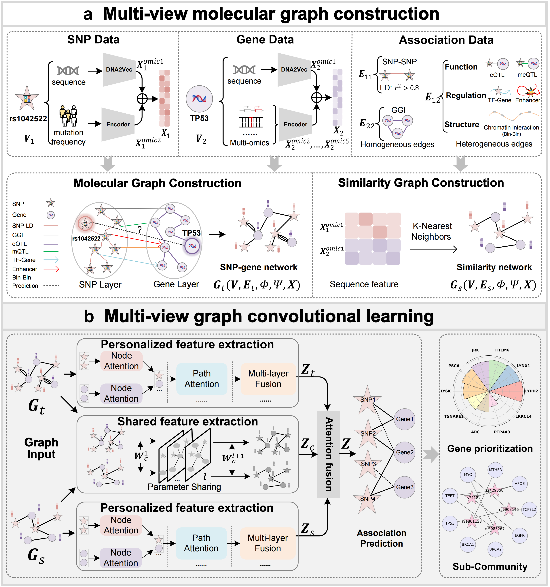

# McV2G

## 1. Project overview
McV2G is a graph neural network framework for predicting associations between single nucleotide polymorphisms (SNPs) and genes. It builds and trains a dual-graph model that leverages a real interaction graph and a feature-based (sequence/similarity) graph, and uses contrastive learning together with link prediction. The implementation uses PyTorch and PyTorch Geometric (PyG).

## 2. Repository structure
- `McV2G.py`: Main script (model definitions, training loop with 5-fold cross-validation, and prediction export).
- `environment.yml`: Conda environment export (Python 3.8, PyTorch, PyG, and related packages).
- `demo_data/`: Example dataset for running the pipeline (sample data only; replace with your own data for real experiments):
    - `adj_real_2.txt`: Real adjacency matrix.
    - `data_2.pth`: Prebuilt PyTorch Geometric `HeteroData` for the real SNP–gene graph (also used to obtain the SNP/gene split).
    - `feature_str.txt`: Features for building the k-NN sequence/similarity graph.
    - `node_feature.txt`: Node feature matrix (SNPs first, then genes).
    - `snp_list_demo_data.txt`: Example list of test SNPs (metadata; not required by `McV2G.py`).
    - `test_edge_index.txt` / `test_edge_name.txt`: Candidate test edges (index and name forms) to score at inference.
- `Result/`: Output directory for prediction files. Contains `fig1.png` (method schematic).

## Method (Overview)
To address limitations in current studies, we propose McV2G, a multi-channel graph convolutional network (McGCN) framework for gene prioritization at GWAS variants. Specifically, McV2G is designed with three key points:

- (i) It explicitly models the synergistic effects of multiple loci rather than considering the impact of each SNP in isolation.
- (ii) It systematically integrates diverse types of genetic relationships by constructing an SNP–gene heterogeneous network and a prior sequence-similarity network, thereby capturing regulatory mechanisms at different levels.
- (iii) It introduces a McGCN to capture key genetic information from the SNP–gene heterogeneous network and the sequence-similarity prior network. The shared channel employs parameter sharing and a contrastive loss to achieve cross-network feature alignment. Meanwhile, the personalized channel incorporates a multi-level attention mechanism to capture key genetic information. Based on the above techniques, McV2G empowers the discovery of complex genetic relationships.



## 3. Requirements & dependencies
Recommended Python: 3.8+.

Primary packages:
- torch (PyTorch)
- torch-geometric (PyG)
- scikit-learn
- pandas
- numpy

You can recreate a working environment from the provided export:

```bash
conda env create -f environment.yml
conda activate Bio
```

Or install the core stack manually (adjust CUDA / PyTorch versions as needed):

```bash
python -m venv .venv && source .venv/bin/activate
pip install --upgrade pip
pip install numpy pandas scikit-learn
pip install torch torchvision --index-url https://download.pytorch.org/whl/cu118
pip install torch-geometric
```

If PyG installation fails, follow https://pytorch-geometric.readthedocs.io/.

## 4. Quick start: training
The command below uses the bundled example dataset (`demo_data/`). For real experiments, point `--data_dir` to your own data with the same file layout.

```bash
python McV2G.py --dataset demo_data --data_dir demo_data --output_dir Result --epochs 200 --hidden_dim 256 --out_dim 128 --dropout 0.4 --num_heads 4 --num_layers 4 --learning_rate 0.007 --temperature 0.1 --patience 10 --t 0.1 --k 3
```

Notes:
- `--dataset`: label used in output filenames (default: `demo_data`).
- `--data_dir`: dataset folder (default: `./demo_data`).
- `--output_dir`: where predictions are written (default: `./Result`).
- Other flags are defined in `args_parser()` inside `McV2G.py`.

After training, each fold writes a prediction file such as:

```text
Result/prediction_0_demo_data.txt
...
Result/prediction_4_demo_data.txt
```

Each line is space-separated: `region gene pred_score rank` (ranked within each region/SNP).

## 5. Input data layout
For a custom dataset, place the following under `--data_dir`:

| File | Required | Description |
|------|----------|-------------|
| `adj_real_2.txt` | yes | Real adjacency matrix |
| `node_feature.txt` | yes | Node features (SNPs then genes) |
| `feature_str.txt` | yes | Features for the k-NN similarity graph |
| `test_edge_index.txt` | yes | Test edge indices to score |
| `test_edge_name.txt` | yes | Test edge names (`SNP gene`) |
| `data_2.pth` | recommended | Prebuilt real graph; also provides SNP count |
| `snp_list.txt` | optional | Full SNP list; only needed if `data_2.pth` is absent |

Node ordering must be SNPs first, then genes. When `data_2.pth` is present, the number of SNP nodes is taken from that object.

## 6. Troubleshooting
- CUDA not found: install a matching PyTorch CUDA build, or run with `--device cpu`.
- PyG install issues: pick wheels that match your PyTorch / CUDA versions.
- Missing inputs: ensure `demo_data/` (or your `--data_dir`) contains the required files above.
- Shape / indexing errors: check that `node_feature.txt` and `feature_str.txt` share the same number of rows, and that test-edge indices fall within the node range.

## 7. License & contact
No license file is included in this repository. Please confirm licensing with the project owner before reuse or redistribution.
